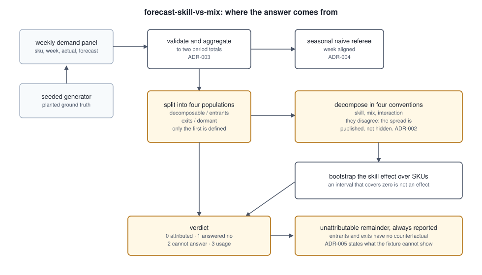

# forecast-skill-vs-mix

**Splits a change in portfolio forecast accuracy into the part your team earned and the part the catalogue handed you. On the fixture here, a 2.86 point WMAPE improvement is 41% skill and the rest is mix shift and SKUs nobody can attribute.**

[](https://github.com/GITHUB_USERNAME/forecast-skill-vs-mix/actions/workflows/ci.yml)


## The thing a WMAPE number cannot tell you

Portfolio WMAPE is a volume weighted mean of per SKU errors. Between two periods, two
things move: the errors and the weights. The resulting number carries both and has no
structure that separates them, so **a portfolio accuracy improvement cannot say whether
anyone forecast better.** This is not a precision problem that a better metric fixes.
The information is destroyed at the point of aggregation.

Four questions this answers that a quarterly accuracy report cannot:

1. Of an accuracy improvement, how much came from forecasting better and how much from
   the catalogue tilting toward items that were always easier to forecast?
2. How much of the change belongs to SKUs that launched, were discontinued, or went
   dormant, and therefore cannot be attributed at all?
3. Is the measured skill effect larger than what a different sample of SKUs would have
   produced by chance?
4. Did the forecast beat a seasonal carry forward that nobody tuned?

## The uncomfortable numbers

On the committed fixture, a panel of 240 SKUs over 104 weeks:

- **1.16 points is skill, 1.38 points is mix**, out of a 2.86 point improvement. The
  planning team earned less than half of a number they would normally present whole.
- **0.32 points cannot be attributed to either**, and the SKUs responsible are 6.4% of
  volume. 199 SKUs are decomposable; 41 are excluded because no per SKU percentage error
  is defined for them.
- **The four standard decomposition conventions put between 33% and 48% of the
  improvement on skill**, a spread of 0.43 points. That spread is the size of a modelling
  choice, not a measurement, and this tool prints all four rather than picking quietly.
- **The forecast beats a seasonal naive referee on 46% of SKUs and 74% of volume.** It
  loses on 54% of the SKUs it was asked to predict. Those two ways of counting are 28
  points apart depending on which you report.

167 tests, 100% line coverage, and every figure above is re-measured by CI from the
experiments and checked against this document's wording on every push. If a number here
stops matching what the code produces, the build fails.

## Quickstart

Requires Python 3.11 or newer. No API keys, no network, no cloud credentials.

```bash
git clone https://github.com/GITHUB_USERNAME/forecast-skill-vs-mix.git
cd forecast-skill-vs-mix
python -m pip install -e ".[dev]"

# the headline number, from the committed fixture
python -m fsvm.cli attribute --panel data/fixtures/panel-realistic.csv

# re-measure everything and check this README against it
make verify
```

`make verify` runs lint, the test suite, all six experiments, and the number checker,
offline, from a fresh clone.

## Claim 1: less than half of this improvement was skill

```
convention       skill       mix  interaction   sums to
------------------------------------------------------
laspeyres        -0.95     -1.60        +0.00     -2.55
paasche          -1.38     -1.17        +0.00     -2.55
three_term       -0.95     -1.17        -0.43     -2.55
shapley          -1.16     -1.38        +0.00     -2.55
```

Each convention is exact: the effects sum to the restricted change to floating point
tolerance, pinned by a test for all four. They differ only in which period's values are
held constant, which is a definition rather than a measurement. Shapley is reported by
default because it is the only one of the four symmetric in the two periods, so the
answer does not depend on which period the analyst called the base. ADR-002 has the
reasoning.

The honest reading of that table: the split is 33% to 48% skill depending on a choice
the data does not make for you. Any single number from this family is a convention.

## Claim 2: the method recovers a planted answer

Validating an attribution tool against real data is circular, because the true split is
unobservable. So two fixture scenarios are built with the answer planted:

| Scenario | Construction | True effect | Worst measured residual |
| --- | --- | --- | --- |
| `pure_mix` | per SKU errors identical in both periods | skill is exactly zero | 6 orders of magnitude below the change |
| `pure_skill` | each SKU's period volume held constant | mix is exactly zero | 6 orders of magnitude below the change |

All four conventions recover both planted zeros. The residual is the fixture's three
decimal rounding, not method error, and it is pinned by a test so it cannot drift
upward unnoticed.

## Claim 3: a small category cannot support a skill claim at all

The skill effect is a weighted sum over a sample of SKUs, so its resolution is bounded
by how many there are. Resampling the decomposable population at several sizes, 150 trials each:

| SKUs | Interval excludes zero | Median interval width |
| --- | --- | --- |
| 20 | 18% | 4.14 points |
| 40 | 39% | 3.01 points |
| 80 | 51% | 2.16 points |
| 120 | 71% | 1.78 points |
| 160 | 95% | 1.53 points |
| 199 | 100% | 1.40 points |

At this effect size you need about 160 SKUs before the interval excludes zero at least
80% of the time. Below that the point estimate still prints a number, and that number is
not evidence. At 20 SKUs the effect is detected 18% of the time, which is to say a
category that small cannot support the claim whatever the estimate reads.

The absolute threshold is a property of this panel's effect size. The shape is not.

## Claim 4: how you count decides whether the forecast is any good

| Counting | Beats seasonal naive |
| --- | --- |
| Per SKU, unweighted | 46% |
| Weighted by volume | 74% |

The model wins on the volume and loses on the SKU count, because the SKUs it loses on
are small. Both numbers are true and they support opposite conclusions, which is the
aggregation problem from the top of this README showing up in the baseline comparison as
well as in the headline metric.

## What the measurement found

**A referee that reached back an arbitrary number of weeks.** The seasonal naive baseline
originally shifted by 52 rows. That is only the same as 52 weeks when every SKU has a row
for every week, and a sales extract omits weeks with no sales. Dropping zero sales rows
from this project's own fixture, which is exactly what a sparse ERP extract looks like,
moved the unweighted beat rate by 18.9 points. Aligning on week numbers and densifying
first brought that to 4.8 points, removing 14.1 points of that swing as pure artefact.
The remainder is genuine information loss: a sparse extract has fewer weeks carrying a
recorded forecast, so 12 SKUs fall below the minimum and are reported as undefined rather
than silently scored. The superseded implementation is kept in `experiments/exp06` so the
size of the bug can be re-measured instead of remembered. ADR-004.

**A decomposition that was short by its own cross term.** An early Paasche form used
period one weights in the skill term and period one errors in the mix term, so the two
effects double counted the interaction and the decomposition did not sum to the change.
An inexact decomposition lets a residual masquerade as skill, which is the one failure
this repository cannot tolerate. Every convention now has a test asserting exactness.

**A churn sweep that compared a different panel at every level.** The dormant SKU set was
drawn from the same id range as the churning one, so raising churn also swapped which
SKUs went dormant and the resulting curve was not monotonic in anything. Pinning the
dormant set to the top of the id range made the levels nested. The experiment now shows
the unattributable share rising to 50% of the change at 40% catalogue churn.

**Three guards that could never fire.** Coverage, not review, found that
`split_populations` already admits only SKUs with positive demand in both periods, so the
zero denominator checks downstream were unreachable. They were deleted and the invariant
pinned by a test, rather than silenced with a pragma.

## Architecture



## What is in the fixture

A seeded generator, not a sample of real demand. 240 SKUs over 104 weeks across four
archetypes: steady seasonal, promotion driven, long tail, and intermittent. The awkward
cases are deliberate:

- **Launches and discontinuations** that exist in only one period, so they have no
  counterfactual and sit outside any decomposition.
- **SKUs that go dormant for a whole period**, present in both periods with zero demand
  in one. These are the population most often silently dropped, because a percentage
  error needs a denominator.
- **Intermittent items** with demand in roughly a third of weeks, which is what makes the
  extract format bug above possible.
- **A mix shift that flatters the forecast**: period one volume tilts toward the
  forecastable archetypes and away from the intermittent tail, so portfolio WMAPE improves
  without anyone forecasting better.

## What this cannot measure

- **Timing error inside a period.** Errors are computed on period totals, so a forecast
  that is consistently two weeks early scores as perfect here and would still cause
  stockouts. This tool supports a period accuracy claim; it does not say whether a
  forecast is fit for replenishment. ADR-003.
- **Whether the split agrees with expert judgement.** The fixture proves the method is
  sound and the implementation correct. It cannot prove the method is useful on your
  data, because no real dataset carries a labelled true split. ADR-005 states which
  claims survive the fixture and which one genuinely needs real data.
- **An absolute beat rate that transfers.** 46% is a property of this generator's
  constructed forecast. The 28 point gap between the two ways of counting is a property
  of skewed volume, which every real portfolio has.
- **Causes.** The tool says how much of a change was mix. It does not say why the mix
  moved, and a mix shift caused by a deliberate rationalisation is a different
  conversation from one caused by a supply failure.

## Layout

```
src/fsvm/
  metrics.py     WMAPE, MAPE, bias, MASE, and the weighted mean identity the
                 decomposition depends on, asserted rather than assumed
  panel.py       validation, period aggregation, the four way population split
  decompose.py   four conventions, each exact, plus the spread between them
  baseline.py    week aligned seasonal naive referee and extract densification
  resample.py    bootstrap interval for the skill effect
  report.py      verdict policy, kept separate from the arithmetic
  cli.py         three subcommands, four exit codes
experiments/     six experiments writing JSON to docs/experiments/
tools/           collect_metrics.py, check_numbers.py, render_diagram.py
docs/adr/        five decision records
data/fixtures/   the committed demand panel
```

## Exit codes

| Code | Meaning |
| --- | --- |
| 0 | attributed: the improvement survives the skill test |
| 1 | the analysis ran and the answer was no |
| 2 | the analysis could not be run on this panel |
| 3 | usage error |

1 and 2 are distinct on purpose. A planning team wiring this into a monthly review needs
to read the report on 1 and page someone on 2, and a single non zero code makes that
impossible without parsing stderr.

## Make targets

| Target | What it does |
| --- | --- |
| `make lint` | ruff check and format check |
| `make test` | pytest with coverage and machine readable reports |
| `make experiments` | re-run all six experiments |
| `make fixture` | regenerate the committed demand panel |
| `make receipts` | re-measure every published figure, then check this README against it |
| `make verify` | lint, test, receipts |

`tools/check_numbers.py` matches **anchor phrases** rather than bare digits, because a
digit search passes while the sentence around it has gone stale: "10 SKUs" is still found
in a document that now says "10 weeks". It also reports, without failing, any number in
this README that corresponds to no measured metric, since that is a number nothing
re-measures.

## Tech stack

| Technology | Role here | Why this one |
| --- | --- | --- |
| Python 3.11+ | everything | `zip(strict=True)` catches length mismatches that would otherwise truncate a weights array silently |
| numpy | the decomposition arithmetic | the effects are dot products of weight and error vectors, which is what the convention table is literally made of |
| pandas | panel reshaping and the population split | `pivot_table` across two periods is the operation that defines the four populations |
| pytest | 167 tests | parametrising over four conventions is how exactness is pinned without four copies of each test |
| ruff | lint and format | one tool, so a contributor cannot pass lint and fail format |
| GitHub Actions | re-measurement | the numbers in this README are only trustworthy if something recomputes them without being asked |

Deliberately absent: a forecasting library. This repository measures forecasts rather
than producing them, and a model here would invite the reader to evaluate the model
instead of the attribution.

## Decision records

- [ADR-001: Decompose the WMAPE change rather than reporting a better portfolio metric](docs/adr/ADR-001-decompose-rather-than-report-a-portfolio-metric.md)
- [ADR-002: Report four decomposition conventions rather than choosing one](docs/adr/ADR-002-report-four-conventions-rather-than-choosing-one.md)
- [ADR-003: Aggregate weekly rows to period totals before computing error](docs/adr/ADR-003-aggregate-to-period-totals-before-computing-error.md)
- [ADR-004: Align the seasonal referee on week numbers, and densify before scoring](docs/adr/ADR-004-align-the-seasonal-referee-on-weeks-not-rows.md)
- [ADR-005: What a seeded fixture can and cannot establish](docs/adr/ADR-005-what-a-seeded-fixture-cannot-establish.md)

## The Pivot

**Out of scope: attributing the mix shift itself.** The tool says how much of a change was
mix. A planner's next question is which SKUs or categories drove it, which needs a
contribution ranking and a stability test so that a ranking built on two periods is not
mistaken for a trend.

That is deliberately not built, because it changes the tool's claim from "this much was
mix" to "these items caused it", and the second claim needs more periods than a two
period comparison has. The trigger for adding it: a user with at least eight periods of
history who wants to act on the mix finding rather than discount the skill one.

## Future work

- Within period timing error alongside period total error, which is what ADR-003 gives up.
- A paired comparison across more than two periods, so the skill effect can be tested for
  trend rather than for a single difference.
- Weighting by margin or cost instead of volume, since a WMAPE improvement concentrated
  in low margin items is worth less than the same improvement elsewhere.
- A written assumption file for the densification rule, so a user whose extract treats
  missing weeks as missing data rather than as zero can declare that instead of editing
  code.

First metric to watch on any of these: the unattributable share. If it rises above the
35% default, the tool should keep refusing to report a split, and any new feature that
makes that number easier to ignore is the wrong feature.

## Licence

MIT. See [LICENSE](LICENSE).
